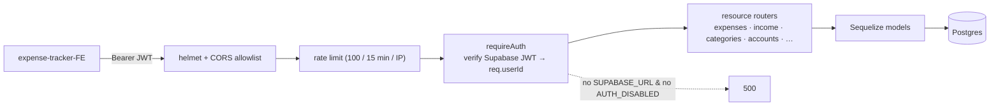

# Expense Tracker — API

REST API for a personal expense & income tracker. Express 5 + Sequelize + Postgres, with Supabase JWT authentication and per-user data scoping.

Frontend: **[expense-tracker-FE](https://github.com/petryga/expense-tracker-FE)** · **Live demo:** [expense-tracker-fe-nu.vercel.app](https://expense-tracker-fe-nu.vercel.app) (click **Try the demo**)

## What it does

- Expenses and income entries, with recurring templates that materialise on a schedule
- User-defined categories with per-category monthly budgets, plus a shared set of defaults
- Accounts, and a rolling `MonthlyData` summary kept in sync as entries change
- CSV export of all expenses
- A **demo account**: when `DEMO_USER_ID` is set, that user's data is wiped and reseeded with fresh fake data on every login, so the public demo always looks alive without exposing real data

## Stack

| | |
|---|---|
| Runtime | Node 24, TypeScript (ESM) |
| Web | Express 5, `helmet`, `cors`, `express-rate-limit` |
| Data | Postgres via Sequelize 6 (`sequelize-cli` migrations + seeders) |
| Auth | Supabase-issued JWTs, verified with `jose` against the project's JWKS |
| Tests | Vitest + `supertest` |
| CI | GitHub Actions — lint, typecheck, migrate + seed against a real Postgres, tests |

## Architecture

```
index.ts            entry point + production-safety guards
app.ts              Express app: helmet → CORS allowlist → rate limit → requireAuth → routers
middleware/auth.ts  verifies the Supabase JWT, sets req.userId (or 401)
services/*.ts       one router per resource; every query is scoped to req.userId
models/*.ts         Sequelize models
utils/*.ts          pure helpers (monthly-data math, CSV formatting, demo-data generation)
migrations/         schema history — `npm start` runs these on every deploy
seeders/            shared default categories / accounts, and demo templates
```

Every route handler filters by `req.userId`; mutations do a `findOne({ where: { id, userId } })` ownership check before touching a row. There is no raw SQL — all queries go through Sequelize.



## Security

- **Auth**: `requireAuth` extracts the `Authorization: Bearer <token>`, verifies it against Supabase's JWKS (`ES256`/`RS256`; a legacy `hs256` shared-secret mode is also supported), and sets `req.userId` from the `sub` claim. No valid token → `401`.
- **Fail closed**: with no `SUPABASE_URL` the API refuses to serve requests (`500`) unless `AUTH_DISABLED=true` is set explicitly (local dev / CI). A production start without either aborts at boot.
- **Per-user isolation**: enforced in every service, not just at the auth boundary.
- `helmet` defaults, an env-driven CORS **allowlist** (not `*`), `express-rate-limit` (100 req / 15 min), and `trust proxy` so the limiter buckets per client behind a PaaS proxy.

## Running locally

```bash
npm install
cp .env.example .env          # fill in DB_* ; leave SUPABASE_URL blank + AUTH_DISABLED=true for no-auth dev
npm run migrate
npm run seed
npm run dev                   # http://localhost:3000
```

Need a throwaway Postgres? `docker compose up -d` starts one on `127.0.0.1:5433` (set `DB_PORT=5433`). It's for rehearsing migrations against a disposable database — see `docker-compose.yml`.

To enable auth, set `SUPABASE_URL` (and drop `AUTH_DISABLED`); the frontend must then send Supabase access tokens.

## Commands

| | |
|---|---|
| `npm run dev` | dev server, auto-restart |
| `npm run build` | compile to `dist/` |
| `npm start` | `migrate` then run — what production does on deploy |
| `npm run migrate` / `migrate:undo` | Sequelize migrations |
| `npm run seed` | seeders (from-scratch databases only) |
| `npm test` | Vitest |
| `npm run lint` / `npm run typecheck` | both fail on any warning |

## Configuration

See `.env.example` for the full list. Key vars: `DB_*`, `SUPABASE_URL`, `AUTH_DISABLED`, `FRONTEND_URL` (CORS allowlist), `DEMO_USER_ID`.

## License

All rights reserved. Published for portfolio review; not licensed for reuse.
